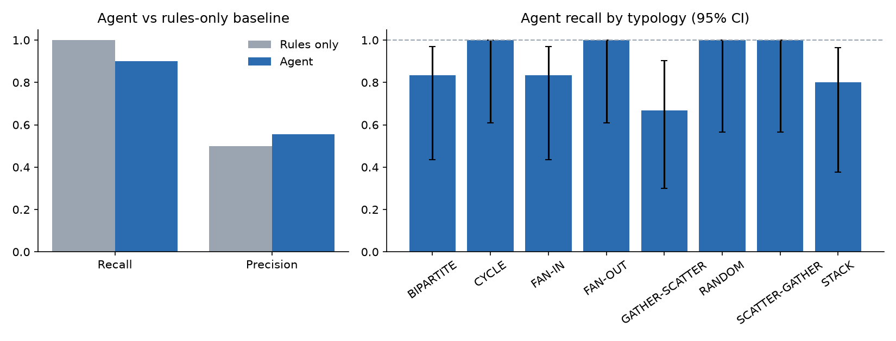
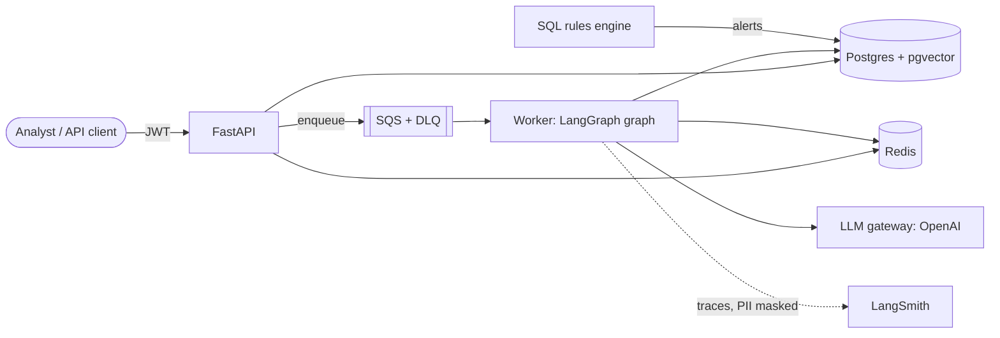

# AML Alert Investigation Agent

A deterministic SQL rules engine raises anti-money-laundering alerts on the IBM synthetic AML dataset. A LangGraph agent investigates each alert, closes it or escalates it with a cited, grounded verdict, and a human analyst approves escalations. Every verdict is scored against the dataset's ground-truth labels and compared with a rules-only baseline.

## Headline result

100 alerts (50 truly laundering, 50 false), frozen and stratified (`eval/datasets/eval-100.json`). Planner `gpt-4o-mini`, assessor `gpt-4o`. Run `full-100-v1`; full report in [`docs/results/eval-full-100-v1.md`](docs/results/eval-full-100-v1.md), raw rows in [`docs/results/eval-full-100-v1.json`](docs/results/eval-full-100-v1.json).



| | Rules only (escalate every alert) | Agent |
|---|---|---|
| Recall of true laundering alerts | 100.0% | 90.0% (95% CI 79-96%) |
| Precision of escalations | 50.0% | 55.6% (45-66%) |
| Alerts sent to an analyst | 100 | 81 |
| Launderers missed | 0 | 5 |
| False alerts closed | 0 | 14 |

The agent removes 19.0% of the analyst workload and lets 10.0% of true alerts through. Whether that trade is acceptable is a policy choice, not something this project decides. Grounding rate is 100.0% (every verdict cites evidence ids that exist in state), mean cost $0.0175 per case, mean latency 11.5 s.

### Limitations (read these before quoting the numbers)
- **Typology accuracy is 0%.** The prompt tells the model to answer null unless the pattern structure is visible, so it rarely names one, and was wrong when it did. This is a prompt problem, not a scorer bug, and it is not fixed.
- **The eval thresholds are a regression floor, not a generalisation claim.** `eval/thresholds.json` was set from the same 100 alerts. Tuning prompts against that set would overfit it; a held-out split must come first.
- **One model pair and one run.** Confidence intervals are wide (n = 50 true alerts); per-typology rows have 5-6 alerts each.
- **Load numbers use a fake LLM on a laptop.** See below.
- **AWS:** the Terraform is code-complete and validated in CI but has not been applied to a real account, so there are no deployed-stack numbers.
- **The analyst console (F14) is a separate project and is not built.** Analysts use the API (Swagger UI at `/docs`).

## Architecture



More detail, including the graph and the AWS topology: [`docs/architecture.md`](docs/architecture.md), [`docs/architecture-aws.md`](docs/architecture-aws.md).

### What the agent does
`load_alert → load_kyc → recall_history → plan → tool_loop (max ~8 calls) → assess → validate_grounding → close_case | draft_sar → human_review (interrupt) → write_memory`

- **Tools:** transaction query, 2-hop counterparty network (recursive CTE), sanctions screen (trigram match, Redis-cached), adverse-media search (pgvector), peer comparison.
- **Guardrails:** Pydantic verdicts; a deterministic grounding check rejects any cited evidence id that is not in state (one retry); the LLM never does arithmetic (SQL/Python computes); a prior analyst-approved escalation blocks auto-close; per-case cost budget sends over-budget cases to human review.
- **Durability:** SQS with DLQ, `PostgresSaver` checkpoints, idempotent side effects. A killed worker's cases resume from their checkpoints.
- **Memory:** long-term per-customer history in `PostgresStore`, used as context and never as evidence.
- **Auth:** JWT (Cognito-compatible), analyst and supervisor roles, audit log on every decision.

## Load test (fake LLM, everything else real)

1,000 real investigations through API, SQS, worker, graph, Postgres and Redis, with the LLM replaced by a deterministic stand-in so the run measures this system and not OpenAI. One laptop, Docker VM with 8 CPUs and 4 GB.

| | |
|---|---|
| Cases finished | 1000 / 1000 in 215 s |
| Throughput (steady state) | 287 cases/min (was 40 before fixes) |
| Errors / duplicates / DLQ | 0 / 0 / 0 |

Source: [`docs/results/loadtest-full-1000.md`](docs/results/loadtest-full-1000.md); method, findings and failure drills (worker kill, Redis outage, 10% LLM errors, all passed) in [ADR 0009](docs/adr/0009-f16-load-test.md). Two real bottlenecks were found and fixed: an unindexed alias scan in sanctions screening (3.96 s to 0.06 s per call) and a too-small worker DB pool. With the real OpenAI API the ceiling is the configured rate limiter, about 130 cases/min at the default setting.

## Run locally
```bash
uv venv --python 3.12 && source .venv/bin/activate
uv pip install -r requirements-dev.txt
cp .env.example .env                # add OPENAI_API_KEY for real runs
docker compose up -d --build        # postgres, redis, localstack, migrate, api (:8000), worker
curl localhost:8000/health
pytest
```
Walkthrough of an alert through investigation and approval: [`docs/demo.md`](docs/demo.md). The data load (Kaggle HI-Small, ~5M rows) is described in [`docs/features/F02-ingestion.md`](docs/features/F02-ingestion.md).

Re-score without spending money: `python -m scripts.eval_gate --mode replay`. A live run (`python -m scripts.eval_run`) costs about $2 per 100 alerts.

## Deploy to AWS
Terraform in `infra/` builds the VPC, ECS Fargate services (API, worker), RDS Postgres, ElastiCache Redis, SQS + DLQ, Secrets Manager, CloudWatch alarms and autoscaling, with optional Cognito. See `infra/README.md`, [`docs/runbook-aws.md`](docs/runbook-aws.md) and [ADR 0010](docs/adr/0010-f17-aws-terraform.md). Estimated cost is about $6-7 per day while it runs (mostly NAT, RDS, Redis, ALB, Fargate), so `terraform destroy` after each session. The dev ALB only admits the IPs you list, and API auth is `AUTH_MODE=jwt` (off by default for local work).

## Decisions and docs
- [ADR index](docs/adr/README.md): why each major choice was made.
- [Feature index](docs/features/README.md): specs F00-F18 and a plain-language `Fxx-explained.txt` for most.
- Original design: `AML_Alert_Investigation_Agent_Project.md`. Contributor and Claude Code notes: `CLAUDE.md`.

## Repo map
`app/` agent, API, worker, rules, eval, loadtest, services · `alembic/` migrations · `scripts/` loaders, eval, load test, AWS helpers · `eval/` frozen dataset, thresholds, fixtures · `infra/` Terraform · `tests/` unit and integration · `docs/` specs, ADRs, results.
