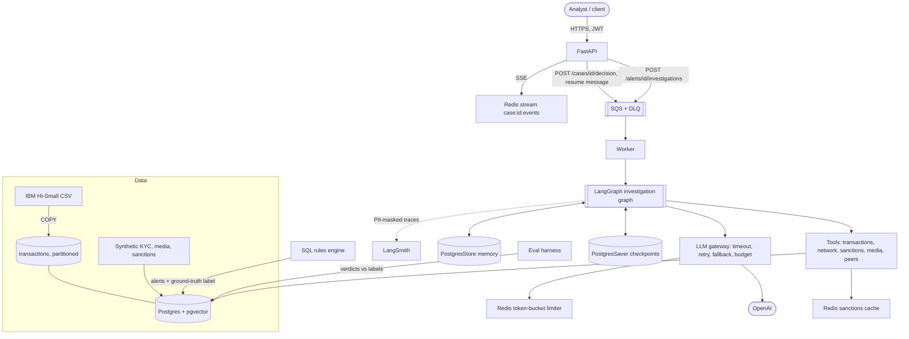

# Architecture

## System



## Investigation graph

```mermaid
flowchart TD
  A[load_alert] --> B[load_kyc] --> C[recall_history] --> D[plan] --> E[tool_loop<br/>max ~8 calls] --> F[assess<br/>Pydantic verdict] --> G{validate_grounding}
  G -->|unknown evidence id, first failure| F
  G -->|grounded, low risk, confident,<br/>no prior approved SAR| H[close_case]
  G -->|otherwise| I[draft_sar] --> J[/human_review<br/>interrupt()/]
  J -->|POST /cases/id/decision<br/>resume| K[write_memory]
  H --> K --> Z((END))
```

Routing lives in `app/agent/routing.py`; the graph is built in `app/agent/graph.py`. A case stops at `human_review` until a decision resumes it from its checkpoint, so a worker crash or a deploy never loses the case.

## Where state lives

| Concern | Store | Notes |
|---|---|---|
| Transactions, alerts, cases, decisions, audit log | Postgres | transactions partitioned by month |
| Short-term memory | `PostgresSaver` | one thread per case |
| Long-term memory | `PostgresStore` | `("customer_history", entity_id)` |
| Sanctions cache, rate limiter, case locks, SSE | Redis | every use degrades if Redis is down |
| Work queue | SQS + DLQ | LocalStack locally |

AWS deployment topology: [`architecture-aws.md`](architecture-aws.md).
